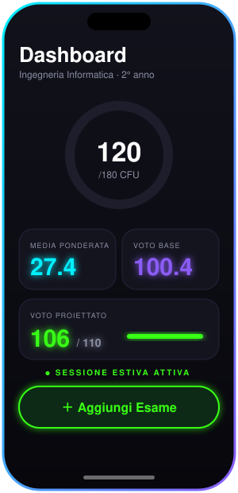
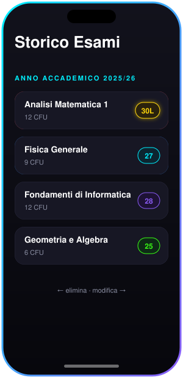
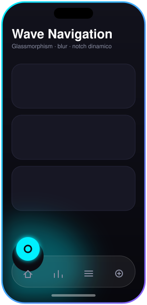
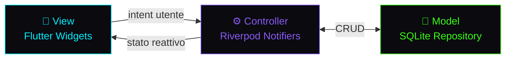

<div align="center">



<a href="https://git.io/typing-svg">
  
</a>

<br/>


<br/><br/>


</div>

<br/>

---

<div align="center">

## 🎬 &nbsp;Showcase

<sub>Ogni schermata è una micro-animazione vettoriale: swipe, slider, glow e wave in loop.</sub>

<br/><br/>

<table>
  <tr>
    <td align="center"><br/><sub><b>📊 Dashboard</b></sub></td>
    <td align="center"><br/><sub><b>🎓 Simulatore Live</b></sub></td>
    <td align="center"><br/><sub><b>👆 Swipe Storico</b></sub></td>
  </tr>
  <tr>
    <td align="center"><br/><sub><b>🍏 Cupertino Sheet</b></sub></td>
    <td align="center"><br/><sub><b>🌊 Wave Nav</b></sub></td>
    <td align="center"><!-- 👉 Sostituisci con la tua GIF:  --><br/><sub><b>🎞️ Demo reale</b></sub></td>
  </tr>
</table>

</div>

---

<div align="center">

## ⚡ &nbsp;Core Features

</div>

<table>
  <tr>
    <td width="33%" valign="top">
      <h3>🧠 Dashboard Intelligente</h3>
      <p><b>Context-Aware.</b> Anelli circolari dei <b>CFU</b>, <b>Media Ponderata</b>, <b>Voto Base di Laurea</b> e <b>Voto Proiettato</b>: tutta la carriera in un solo colpo d'occhio.</p>
    </td>
    <td width="33%" valign="top">
      <h3>🟢 Smart Session UI</h3>
      <p>Riconosce il <b>periodo d'esami</b> e accende i pulsanti d'azione con un <b>green-glow neon</b> quando la sessione è attiva.</p>
    </td>
    <td width="33%" valign="top">
      <h3>📜 Storico Interattivo</h3>
      <p>Esami divisi per <b>anno accademico</b>. <b>Swipe-to-Delete</b> 🔴 e <b>Swipe-to-Edit</b> 🔵 con animazioni fluide e badge per <b>Lode</b> e <b>CFU</b>.</p>
    </td>
  </tr>
  <tr>
    <td width="33%" valign="top">
      <h3>🍏 Voti "Cupertino Style"</h3>
      <p><b>Bottom Sheet</b> dal basso con toggle switch interattivi e campi di input nativi iOS.</p>
    </td>
    <td width="33%" valign="top">
      <h3>🎓 Simulatore di Laurea Live</h3>
      <p>Slider interattivo: l'anello di proiezione vira dinamicamente tra 🔴 🟠 🔵 🟢 in base all'impatto del nuovo voto su <b>media</b> e <b>110L</b>.</p>
    </td>
    <td width="33%" valign="top">
      <h3>🌊 Wave Navigation Bar</h3>
      <p><b>Glassmorphism</b>: notch a onda, blur trasparente e icone galleggianti che colorano l'ambiente.</p>
    </td>
  </tr>
  <tr>
    <td width="33%" valign="top">
      <h3>🌗 Dark / Light Dinamico</h3>
      <p>Supporto totale ai temi di sistema con <b>palette semantiche</b> e ombreggiature morbide.</p>
    </td>
    <td width="33%" valign="top">
      <h3>🌍 Multilingua Automatico</h3>
      <p><b>i18n</b> istantaneo: <b>Italiano</b> o <b>English</b> in base alla lingua del dispositivo.</p>
    </td>
    <td width="33%" valign="top">
      <h3>💾 Persistenza Offline</h3>
      <p>Motore reattivo <b>Riverpod</b> + database <b>SQLite</b>: velocità estrema, zero connessione richiesta.</p>
    </td>
  </tr>
</table>

---

<div align="center">

## 🏛️ &nbsp;Architettura Pulita

<sub>Separazione netta delle responsabilità secondo il pattern <b>MVC</b>, con stato reattivo gestito da Riverpod.</sub>

</div>



| Layer | Responsabilità | Tecnologia |
|:--|:--|:--|
| 🎨 **View** | UI Cupertino, Glassmorphism, animazioni, i18n | Flutter Widgets |
| ⚙️ **Controller** | Logica di media, proiezione 110L, stato reattivo | Riverpod |
| 💾 **Model** | Esami, CFU, anni accademici, persistenza offline | SQLite |

---

<div align="center">

## 🚀 &nbsp;Quick Start

</div>

```bash
git clone https://github.com/<tuo-username>/unitrack.git
cd unitrack
flutter pub get
flutter run
```

---

<div align="center">


<br/>

**Sviluppato da [Enzo Pio Cundari](https://github.com/) — 2026**

<sub>⭐ Se UniTrack ti ispira, lascia una stella al repository ⭐</sub>

</div>
